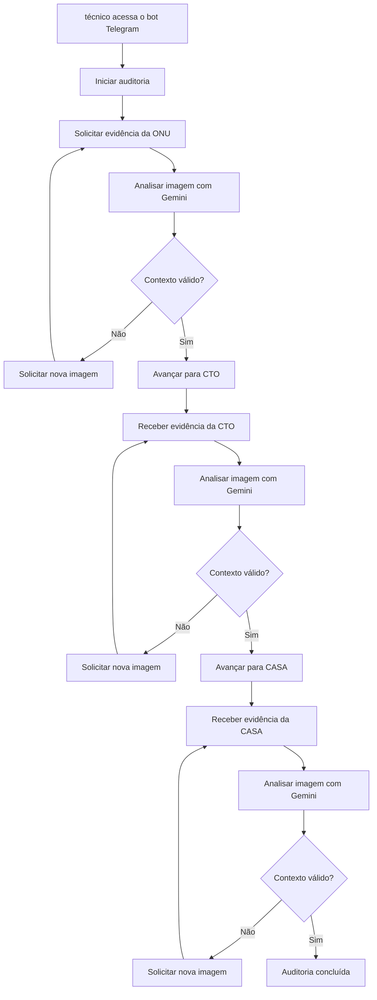

# AmzAuditex — Auditoria Técnica Inteligente

Sistema de automação de auditorias técnicas para provedores de internet, desenvolvido para auxiliar técnicos de campo na validação de evidências fotográficas de instalações e atendimentos.

O AmzAuditex utiliza um bot do Telegram como interface de interação, uma API desenvolvida em NestJS para orquestração das operações e inteligência artificial para análise visual das evidências.

O objetivo é tornar o processo de auditoria mais padronizado, reduzir inconsistências no envio de evidências e facilitar a integração entre as atividades de campo e os sistemas internos do provedor.

---

## Visão geral

O projeto foi pensado para transformar um processo operacional manual em um fluxo guiado e validado.

Durante uma auditoria, o técnico envia fotografias pelo Telegram. Cada imagem é analisada por um serviço de visão computacional, que identifica seu contexto e verifica se ela corresponde à etapa esperada.

O fluxo de auditoria contempla três etapas:

1. **ONU:** identificação da parte traseira do equipamento.
2. **CTO:** validação da evidência de medição de potência na caixa de terminação óptica.
3. **CASA:** validação da evidência de medição no ambiente do cliente.

As imagens são avaliadas de acordo com a etapa atual, evitando que evidências de um contexto sejam aceitas indevidamente em outro.

## Tecnologias utilizadas

| Tecnologia | Aplicação |
|---|---|
| Node.js | Ambiente de execução |
| TypeScript | Linguagem principal do backend |
| NestJS | Arquitetura e construção da API |
| Telegraf | Integração com o Telegram |
| Google Gemini API | Análise de imagens com IA |
| Python | Experimentos e desenvolvimento de visão computacional |
| Ultralytics YOLO | Treinamento e experimentação com detecção de objetos |
| Label Studio | Anotação e preparação de datasets |

## Arquitetura

O backend utiliza uma organização modular inspirada nos princípios de separação de responsabilidades e Domain-Driven Design (DDD).

A estrutura separa as regras de negócio, os casos de uso e os detalhes de infraestrutura.

```text
src/
├── modules/
│   ├── auditoria/
│   │   ├── application/
│   │   │   ├── messages/
│   │   │   └── use-cases/
│   │   ├── domain/
│   │   │   ├── entities/
│   │   │   ├── enums/
│   │   │   ├── repositories/
│   │   │   └── services/
│   │   └── infra/
│   │       ├── errors/
│   │       ├── repositories/
│   │       └── services/
│   │
│   ├── consulta-potencia/
│   ├── gemini/
│   │   └── infra/
│   │       └── services/
│   │
│   ├── hubsoft/
│   └── telegram/
│       ├── application/
│       ├── domain/
│       └── infra/
│           └── handlers/
│
└── shared/
    ├── enums/
    ├── errors/
    └── types/
```

### Responsabilidades dos módulos

- **Telegram:** recebe as interações do técnico e encaminha as operações para a camada de aplicação.
- **Auditoria:** concentra o fluxo, o estado da auditoria e as regras de validação das imagens.
- **Gemini:** encapsula a comunicação com a API de inteligência artificial.
- **Consulta de potência:** módulo destinado às consultas das informações técnicas dos serviços.
- **HubSoft:** concentra as integrações com o sistema de gestão do provedor.
- **Shared:** disponibiliza estruturas e recursos compartilhados.

## Fluxo de auditoria



## Inteligência artificial e análise de imagens

O projeto utiliza o Google Gemini para interpretar as evidências fotográficas e identificar o contexto da imagem.

A integração foi encapsulada em um serviço próprio, evitando que detalhes da API externa contaminem as regras de negócio.

A resposta da IA é interpretada pelo backend e convertida em um resultado utilizado pelo validador de domínio.

Os contextos esperados são:

| Contexto | Descrição |
|---|---|
| `ONU_TRASEIRA` | Parte traseira de uma ONU/ONT |
| `POTENCIA_CTO` | Evidência de medição de potência em uma CTO |
| `POTENCIA_CASA` | Evidência de medição de potência no ambiente do cliente |
| `DESCONHECIDO` | Imagem que não corresponde claramente aos contextos esperados |

### Experimentos com visão computacional

Além da integração com Gemini, o projeto também passou por experimentações com visão computacional utilizando Python, YOLO e datasets anotados no Label Studio.

Essa etapa permitiu explorar treinamento de modelos, detecção de objetos e classificação de evidências técnicas.

## Decisões de arquitetura

Algumas decisões importantes durante o desenvolvimento:

- **Handlers enxutos:** os handlers do Telegram delegam o processamento para os serviços de aplicação.
- **Separação de responsabilidades:** as regras de negócio não dependem diretamente do Telegram ou da API de IA.
- **Validação centralizada:** a identificação do contexto esperado é responsabilidade do domínio.
- **Injeção de dependências:** os serviços e repositórios são disponibilizados por meio dos módulos do NestJS.
- **Controle de estado:** o fluxo mantém a etapa atual da auditoria e impede o avanço indevido entre etapas.
- **Integrações isoladas:** serviços externos são encapsulados em componentes de infraestrutura.

## Funcionalidades

### Implementadas

- [x] Integração com bot do Telegram.
- [x] Backend modular com NestJS e TypeScript.
- [x] Recebimento e processamento de fotografias.
- [x] Integração com Google Gemini.
- [x] Classificação de imagens por contexto.
- [x] Validação das evidências conforme a etapa da auditoria.
- [x] Controle de estado da auditoria.
- [x] Separação entre domínio, aplicação e infraestrutura.
- [x] Testes automatizados das regras e componentes desenvolvidos.

### Em desenvolvimento / roadmap

- [ ] Autenticação individual dos técnicos pelo Telegram.
- [ ] Associação entre usuário do Telegram e cadastro do técnico no HubSoft.
- [ ] Consulta de clientes e informações de potência pelo PPPoE.
- [ ] Exibição de informações do serviço, equipamento, serial number, RX e TX.
- [ ] Consulta de ordens de serviço vinculadas ao cliente.
- [ ] Envio automático das evidências aprovadas como anexos da ordem de serviço.
- [ ] Persistência de auditorias e histórico de evidências.
- [ ] Containerização com Docker.
- [ ] Estratégia de deploy e alta disponibilidade.

## Execução local

### Pré-requisitos

- Node.js
- npm
- Token de um bot do Telegram
- Chave de API do Google Gemini

### Instalação

Clone o repositório:

```bash
git clone URL_DO_REPOSITORIO
cd NOME_DO_REPOSITORIO
```

Instale as dependências:

```bash
npm install
```

Configure as variáveis de ambiente necessárias em um arquivo `.env`.

Exemplo:

```env
GEMINI_API_KEY=sua_chave_gemini
TELEGRAM_BOT_TOKEN=seu_token_telegram
```

Inicie a aplicação em ambiente de desenvolvimento:

```bash
npm run start:dev
```

> Os comandos e as variáveis de ambiente devem ser conferidos com a configuração atual do projeto antes da execução.

## Testes

O projeto utiliza testes automatizados para validar componentes e regras de negócio.

Para executar:

```bash
npm test
```

## Segurança

- Não compartilhe tokens ou chaves de API.
- Não versione arquivos `.env`.
- Utilize variáveis de ambiente para credenciais.
- Evite expor dados pessoais de clientes e técnicos em logs ou exemplos públicos.

## Objetivo do projeto

O AmzAuditex nasceu de uma necessidade operacional real: tornar a auditoria técnica de provedores de internet mais consistente, rastreável e automatizada.

Mais do que integrar ferramentas, o projeto explora como arquitetura de software, inteligência artificial e automação podem trabalhar juntas para resolver problemas concretos do dia a dia.

---

**Desenvolvido como projeto de engenharia de software aplicada à automação de processos e inteligência artificial.**
